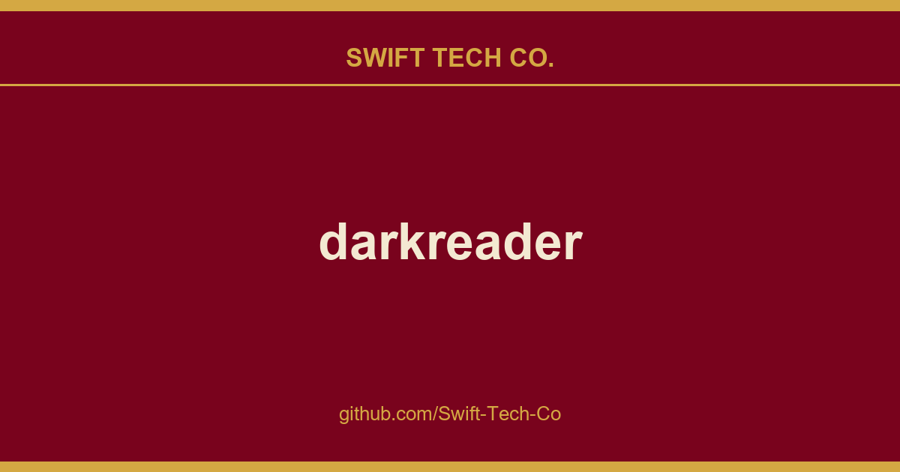

# darkreader

## What This Is

A practical reference entry for product and engineering: the darkreader notes, examples and fixes we reach for repeatedly. Kept current as part of the wider Swift Tech Co. engineering library.

## Images

[](https://github.com/Swift-Tech-Co/darkreader)

## Questions

Most questions can be answered by reading the help page.
If the help page doesn't answer your question, open up a new discussion.

## How to contribute

Read more about contributing to Dark Reader in CONTRIBUTING.md.

## Building for use

Dark Reader build script requires a JavaScript runtime, either Node.js or Deno. We recommend using Node.js, Deno support is experimental.

### Building with Node.js

You can install the extension from a file.
Install Node.js (we recommend LTS or higher, but any version at or above 15 will work). Download the source code (or check out from git).
Open the terminal in the root folder and run:

- `npm install`
- `npm run build` or `npm run build [-- flags]`

This will create a `build/release/darkreader-chrome.zip` file for use in a Chromium-based browser and a `build/release/darkreader-firefox.xpi` file for use in Firefox.

You can customize the build process by passing flags to build script. To see all flags, run `npm run build -- --help`.

### Building with Deno

You can build Dark Reader with an alternative runtime called Deno. For this run `deno:bootstrap` script (e.g., via `npm run deno:bootstrap` or manually copy the command from `package.json`). Then run the same commands described above.

Please note that if you encounter the error `Too many open files (os error 24)`, then you should use the newer version of Deno (preferably built from source or canary).

### Bundling with official Firefox store signatures (experimental)

Before publication, extension stores provide digital signatures for extensions. These digital signatures certify the integrity of the archive (that the extension bundle did not get corrupted or bit-rotted) and that the extension store performed very basic extension validation.

Dark Reader repository contains these digital signatures and you can add them to the extension bundle. The following will build Dark Reader for Firefox version 4.9.63:
```
npm run build -- --firefox --version=4.9.63
```

Please note that only Firefox Add-ons store signatures are present in the repository right now. Also, due to NodeJS and TypeScript version compatibility, one might have to first check out the old revision (commit), then build the extension files, then check out the recent commit and create the bundle (by running only `signature` and `zip` steps).

## Using Dark Reader on a website

You can use Dark Reader to enable dark mode on your website!

- Install the package from NPM (`npm install darkreader`)
- or build from the source code (`npm run api`)
- or include the script via a CDN such as unpkg or jsDelivr

Then you can use the following code to control Dark Reader's API:
```javascript
DarkReader.enable({
    brightness: 100,
    contrast: 90,
    sepia: 10
});

DarkReader.disable();

// Enable when the system color scheme is dark.
DarkReader.auto({
    brightness: 100,
    contrast: 90,
    sepia: 10
});

// Stop watching for the system color scheme.
DarkReader.auto(false);

// Get the generated CSS of Dark Reader returned as a string.
const CSS = await DarkReader.exportGeneratedCSS();

// Check if Dark Reader is enabled.
const isEnabled = DarkReader.isEnabled();
```

... or if you are using ES modules:

```javascript
import {
    enable as enableDarkMode,
    disable as disableDarkMode,
    auto as followSystemColorScheme,
    exportGeneratedCSS as collectCSS,
    isEnabled as isDarkReaderEnabled
} from 'darkreader';

enableDarkMode({
    brightness: 100,
    contrast: 90,
    sepia: 10,
});

disableDarkMode();

followSystemColorScheme();

const CSS = await collectCSS();

const isEnabled = isDarkReaderEnabled();
```

Be aware that Dark Reader will add the `chrome` object onto the `window` object. These are to stub certain functions that the code will use. They originate from the webextension-api.

## Site fixes

Automatically syncing the site fixes for every Dark Reader user was disabled because the GitHub team does not allow using GitHub as a content delivery network (CDN). The storage of these files would be expensive, and making requests to other resources would look suspicious. Each new release of Dark Reader will include the new changes.

However, this can be manually enabled with the following steps:

1. Click on the Dark Reader extension icon.
2. Click on the `Dev tools` button (in the bottom-right corner).
3. Go to `Advanced` and click on the `Preview new design` button.
4. Close the developer tools window and click on the Dark Reader extension icon again.
5. Go to `Settings` -> `Advanced` and enable the `Synchronize sites fixes` setting.

To force a synchronization of the sites fixes (when the corresponding setting is enabled), perform the following steps:

1. Click on the Dark Reader extension icon.
2. Go to `Settings` -> `Advanced` -> `Dev tools`.
3. For each "Editor" section, click on `Reset changes`, confirm with `OK`, and then click on `Apply`. Afterwards, close the developer tools window and reload the desired page(s).

## Enable Dark Reader on restricted pages on Mozilla Firefox

By default, Dark Reader does not work on some websites due to **security restrictions** enforced by Mozilla.

The following instructions will guide you on how to disable those restrictions.

**Proceed with caution. This exposes you to a security risk if you do not know what you are doing.**

**Be sure that you do not have any suspicious or malicious-looking extension installed before proceeding.**

**These settings will apply to all extensions, and not just Dark Reader.**

Step 1: change Dark Reader's settings.

1. Click on the Dark Reader extension icon.
2. Click on the `Dev tools` button (in the bottom-right corner).
3. Go to `Advanced` and click on the `Preview new design` button.
4. Close the developer tools window and click on the Dark Reader extension icon again.
5. Go to `Settings` -> `Advanced` and enable the `Enable on restricted pages` setting.

Step 2: change Firefox's settings.

- Type `about:config` in the address bar and press Enter.
  - A warning page may appear. Click `Accept the Risk and Continue` to proceed.
- Search for and set `extensions.webextensions.restrictedDomains` to an empty value (if the preference does not exist, create it with `String` as the type).
- Set `privacy.resistFingerprinting.block_mozAddonManager` to `true` (if the preference does not exist, create it with `Boolean` as the type).

After changing the necessary settings for both Dark Reader and Firefox, reload the desired page(s).

**If you had previously changed any of the following preferences, please reset them to their default values as they are only related to security and are not necessary for Dark Reader to work on restricted websites.**
To reset them, click on the reset (or delete icon, if present) icon at the most-right corner of the preference line in `about:config`.
- `extensions.quarantinedDomains.enabled`
- `extensions.quarantinedDomains.list`

### Clarification about quarantined domains ("Run on sites with restrictions" option)
<details><summary>Quarantined domains and Dark Reader  an explanation</summary>

The option "Run on sites with restrictions", present for some extensions, is only related to quarantined domains and is not needed for Dark Reader to work on restricted websites. In the context of Firefox's source code, "restricted domains" and "quarantined domains" are two separate things.

**The "restricted domains" list** (controlled by the preference `extensions.webextensions.restrictedDomains`) is the same for all users. It will restrict *all* user-installed extensions (without exceptions) from running on the specified websites. The list is controlled by Mozilla, and, as of December 2024, the list only contains Mozilla-owned domains. Sites that are not on that list will not be affected by those restrictions (meaning that the extensions will be able to run normally).

**The "quarantined domains" list** (controlled by the preferences `extensions.quarantinedDomains.enabled` and `extensions.quarantinedDomains.list`) contains domains that will run extensions normally, but if Firefox detects suspicious activity from a particular extension it will block that extension on those specific websites. The list is controlled by Mozilla, and, as of December 2024, the list only contains domains related to Internet banking in Brazil. For more information about quarantined domains, see "Why are some add-ons not allowed on sites restricted by Mozilla?".

For Dark Reader, the option "Run on sites with restrictions" is not shown because Dark Reader is a Recommended extension by Mozilla. (The "Recommended" status is only relevant for "quarantined domains", and does not affect "restricted domains".)

The fact that it is a Recommended extension means that it meets the "highest standards of security, functionality, and user experience". The quarantined domains are only related to extension security. Because Dark Reader is considered secure by Mozilla, that option is not shown, meaning **it will always run even on quarantined domains** (but will still obey the "restricted domains" list if it is not empty).

Regarding quarantined domains specifically, there is this comment from Firefox's source code:

```
// Privileged extensions and any extensions with a recommendation state are
// exempt from the quarantined domains.
```

A simple way to recapitulate all this information is: "restricted domains" exist to protect Mozilla-owned sites (no user-installed extension will run on them, without exceptions), while "quarantined domains" are meant to protect users from malicious extensions (and it doesn't apply to Dark Reader because it is a Recommended extension).

</details>

<h2 align="center">Contributors</h2>
<br/>
<h3 align="center"><strong>Thank you to all our contributors! Dark Reader exists thanks to you.</strong></h3>
<br/>
<br/>
<p align="center"><a rel="noreferrer noopener" href="https://github.com/Swift-Tech-Co/darkreader"></a></p>

<h2 align="center">Backers</h2>
<br/>
<h3 align="center"><strong>Thank you to all our generous backers! </strong>Support Dark Reader by <a rel="noreferrer noopener" href="https://github.com/Swift-Tech-Co/darkreader" target="_blank">becoming a backer</a>.</h3>
<br/>
<br/>
<p align="center"><a rel="noreferrer noopener" href="https://github.com/Swift-Tech-Co/darkreader" target="_blank"></a></p>

<p>Does your company use Dark Reader? Please ask your manager or the marketing team if your company would be interested in supporting our project. Your support will allow the maintainers to dedicate more time to maintenance and creating new features for everyone. Also, your company's logo will show on <a rel="noreferrer noopener" href="https://github.com/Swift-Tech-Co/darkreader" target="_blank">GitHub</a>. Who doesn't want a little extra exposure? <a rel="noreferrer noopener" href="https://github.com/Swift-Tech-Co/darkreader" target="_blank">Here's the info</a>.</p>

<br/>
<br/>
<a href="https://github.com/Swift-Tech-Co/darkreader" target="_blank" rel="noreferrer noopener"></a>
<a href="https://github.com/Swift-Tech-Co/darkreader" target="_blank" rel="noreferrer noopener"></a>
<a href="https://github.com/Swift-Tech-Co/darkreader" target="_blank" rel="noreferrer noopener"></a>
<a href="https://github.com/Swift-Tech-Co/darkreader" target="_blank" rel="noreferrer noopener"></a>
<a href="https://github.com/Swift-Tech-Co/darkreader" target="_blank" rel="noreferrer noopener"></a>
<a href="https://github.com/Swift-Tech-Co/darkreader" target="_blank" rel="noreferrer noopener"></a>
<a href="https://github.com/Swift-Tech-Co/darkreader" target="_blank" rel="noreferrer noopener"></a>
<a href="https://github.com/Swift-Tech-Co/darkreader" target="_blank" rel="noreferrer noopener"></a>
<a href="https://github.com/Swift-Tech-Co/darkreader" target="_blank" rel="noreferrer noopener"></a>
<a href="https://github.com/Swift-Tech-Co/darkreader" target="_blank" rel="noreferrer noopener"></a>
<a href="https://github.com/Swift-Tech-Co/darkreader" target="_blank" rel="noreferrer noopener"></a>

---

## Swift Tech Co.

Built and maintained by Swift Tech Co.

AI Automation | FinTech Platforms | Custom Software and Mobile Apps | SaaS Platforms | Cloud Infrastructure | Cybersecurity | SEO and Marketing | API Integration

**Join our community on Telegram:** [t.me/+Qt_eFvkb2rliMzNh](https://t.me/+Qt_eFvkb2rliMzNh)

Home | Services | Careers | Referral Program | Influencers | About | Contact

**Connect**

- Website: https://github.com/Swift-Tech-Co/darkreader
- LinkedIn: [linkedin.com/in/stephenoladoke](https://www.linkedin.com/in/stephenoladoke/)
- LinkedIn (Company): [linkedin.com/company/swift-tech-co](https://www.linkedin.com/company/swift-tech-co)
- X: [@MrOladoke](https://x.com/MrOladoke)
- Instagram: [@mr.oladoke](https://www.instagram.com/mr.oladoke/)
- Organization: [github.com/Swift-Tech-Co](https://github.com/Swift-Tech-Co)

## Sources

Compiled and maintained from upstream [darkreader/darkreader](https://github.com/darkreader/darkreader) under permissive open-source license.

---

Maintained by [Swift Tech Co.](https://github.com/Swift-Tech-Co) - [Telegram](https://t.me/+Qt_eFvkb2rliMzNh)

## Sources

Compiled and maintained from upstream [darkreader/darkreader](https://github.com/darkreader/darkreader) under permissive open-source license.

---

Maintained by [Swift Tech Co.](https://github.com/Swift-Tech-Co) - [Telegram](https://t.me/+Qt_eFvkb2rliMzNh)

## Sources

Compiled and maintained from upstream [darkreader/darkreader](https://github.com/darkreader/darkreader) under permissive open-source license.

---

Maintained by [Swift Tech Co.](https://github.com/Swift-Tech-Co) - [Telegram](https://t.me/+Qt_eFvkb2rliMzNh)

## Sources

Compiled and maintained from upstream [darkreader/darkreader](https://github.com/darkreader/darkreader) under permissive open-source license.

---

Maintained by [Swift Tech Co.](https://github.com/Swift-Tech-Co) - [Telegram](https://t.me/+Qt_eFvkb2rliMzNh)